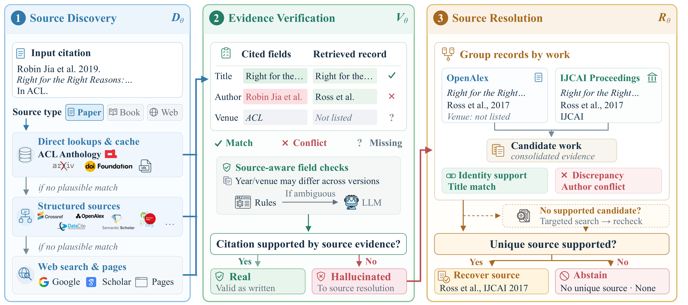

<div align="center">

<h2>CiteANCHOR: Source-Aware Grounding for<br>Hallucinated Citation Detection and Resolution</h2>

<p>
  Chenyi Tong<sup>1</sup>,
  Ping Nie<sup>2</sup>,
  Yu Zhang<sup>3</sup>
</p>
<p><sup>1</sup>University of Wisconsin&ndash;Madison &nbsp; <sup>2</sup>University of Waterloo &nbsp; <sup>3</sup>Texas A&amp;M University</p>

<p>
  <a href="https://arxiv.org/abs/2610.30355"></a>
  <a href="https://oldwizard7.github.io/CiteANCHOR_website/"></a>
  <a href="https://huggingface.co/datasets/cheney777/CiteResolve"></a>
</p>

</div>

CiteANCHOR takes a citation string and returns whether it is valid as written and, if not, the uniquely supported
source or `None`. The CiteResolve benchmark (423 hallucinated citations annotated for source recoverability) is on
[Hugging Face](https://huggingface.co/datasets/cheney777/CiteResolve).



## Results

| Backbone | CiteAudit F1 | **CiteANCHOR F1** | Web Search task success | **CiteANCHOR task success** |
|:--|--:|--:|--:|--:|
| GPT-5.6 Luna | 0.762 | **0.841** | 58.4 | **74.7** |
| OpenResearcher-30B-A3B | 0.416 | **0.784** | 5.4 | **70.7** |

Detection on the CiteAudit real-world test set (3,356 citations) and end-to-end source resolution on CiteResolve (423).

## Quickstart

```bash
git clone https://github.com/oldwizard7/CiteANCHOR_code.git citeanchor
cd citeanchor
pip install openai requests serpapi jinja2       # Python 3.10+
python3 scripts/build_acl_mirror.py --build      # offline ACL Anthology index

export OPENAI_API_KEY=... OPENAI_MODEL=gpt-5.6-luna
export SERPAPI_API_KEY=...                       # Google / Google Scholar; omit and add --no-paid
python3 scripts/run_citeanchor.py --file citations.json --output runs/run.json --no-timestamp
python3 scripts/score_detection.py runs/run.json
```

Input: `{"data": [{"id": 1, "citation": "<reference string>", "GT": true}, ...]}` (`GT`: valid as written).
Each output entry carries the verdict, the deciding rule, the evidence, the named source or `None`, and the full retrieval trace:

```json
{"id": 29, "Pred": true,
 "verification": {"rule": "exact_title_clean", "basis": "evidence_match",
                  "agreements": ["title", "authors", "year", "venue", "identifier"], "conflicts": [],
                  "evidence": {"title": "CiteAudit: You Cited It, But Did You Read It? ...", "arxiv_id": "2602.23452", "source": "arxiv"},
                  "correction": null},
 "trace": {"tiers_tried": ["local", "identifier"], "paid_calls": 0, "elapsed_s": 3.5}}
```

Optional keys: `S2_API_KEY`, `OPENALEX_API_KEY`, `GOOGLE_BOOKS_API_KEY`.
Open-weight backbone: serve the model behind an OpenAI-compatible endpoint, set `OPENAI_BASE_URL`, `OPENAI_MODEL`,
`OS_MODEL_DIR`, and run any script through `PYTHONPATH=src python3 -m citeanchor.local_backbone <script> [args]`.
`scripts/score_citeresolve.py` scores source resolution against [CiteResolve](https://huggingface.co/datasets/cheney777/CiteResolve).

## Citation

```bibtex
@misc{tong2026citeanchorsourceawaregroundinghallucinated,
      title={CiteAnchor: Source-Aware Grounding for Hallucinated Citation Detection and Resolution},
      author={Chenyi Tong and Ping Nie and Yu Zhang},
      year={2026},
      eprint={2610.30355},
      archivePrefix={arXiv},
      primaryClass={cs.CL},
      url={https://arxiv.org/abs/2610.30355},
}
```

MIT License.
